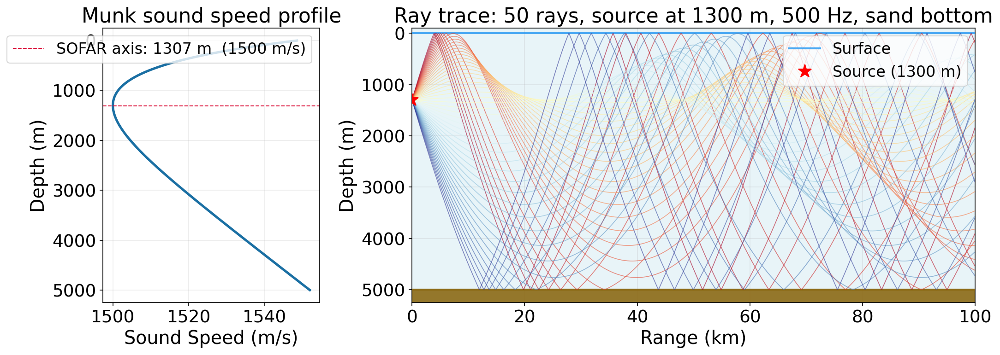
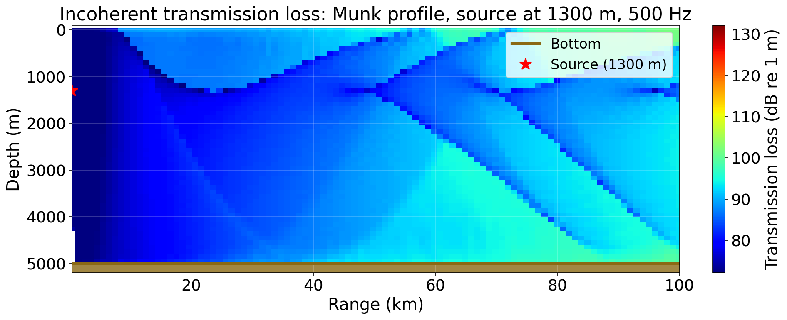
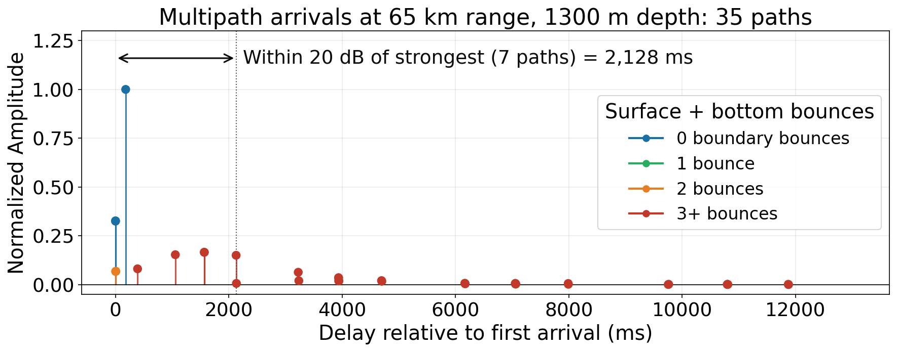
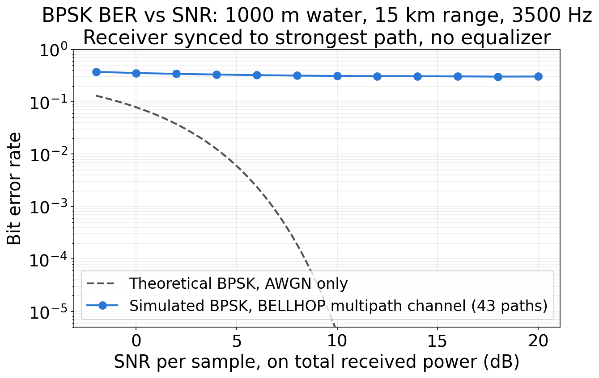
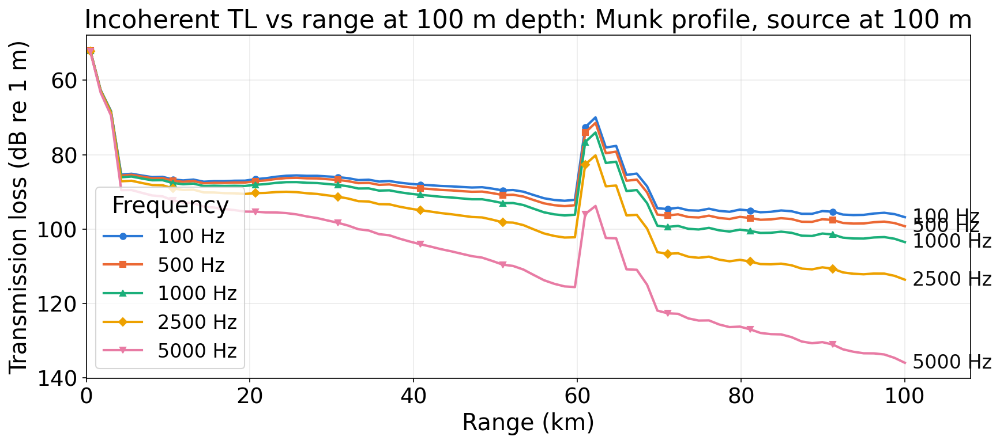

# bellhopSim

Interactive underwater acoustic propagation simulator using [BELLHOP](https://oalib-acoustics.org/)
and the [arlpy](https://github.com/org-arl/arlpy) Python library, with Jupyter widgets for
real-time parameter exploration.

---

## What This Project Simulates

BELLHOP is the standard ray-acoustic propagation model for underwater acoustics,
used in sonar design, ocean tomography, and acoustic communications research.

This notebook suite lets you:

- **Build any sound speed profile** (SSP): Munk deep ocean, shallow water shelf,
  Arctic, surface duct, or custom from (depth, speed) pairs
- **Trace rays** from any source depth through any ocean environment. Visualize
  refraction, shadow zones, and convergence zones in real time
- **Compute 2D transmission loss** maps showing how sound level drops with range
  and depth, with automatic convergence zone detection
- **Analyze multipath arrivals**: see how many ray paths reach a receiver, their
  delay spread, and implications for underwater acoustic communications
- **Run the sonar equation**: convert TL into SNR for a real sensor system
- **Simulate an acoustic comms link**: convolve BPSK symbols through the BELLHOP
  channel and compute BER vs SNR

---

## Prerequisites

### 1. BELLHOP acoustic toolbox (Windows)

BELLHOP must be installed. This repo is configured for:
```
C:\acoustics-toolbox\atWin10_2020_11_4\windows-bin-20201102\bellhop.exe
```

Download from: https://oalib-acoustics.org/models-and-software/acoustics-toolbox/

### 2. Python (3.10+)

Install via [Anaconda](https://www.anaconda.com/) or python.org.

### 3. WSL (Windows Subsystem for Linux), if running from WSL

If you run JupyterLab from WSL, `src/bellhop_config.py` automatically handles the
WSL-to-Windows path conversion so `bellhop.exe` can find its working files.
No manual configuration needed: just call `bc.configure()` at the top of any notebook.

---

## BELLHOP Path Configuration

The key challenge on Windows+WSL is that `bellhop.exe` is a Windows binary that
cannot resolve Linux-style paths like `/tmp/tmpXXX`. The `bellhop_config.py` module
solves this by:

1. Adding `C:\acoustics-toolbox\...\windows-bin-20201102` to `PATH`
2. Setting `TMPDIR` to `C:\Users\<user>\AppData\Local\Temp` (Windows-accessible)
3. Monkey-patching `arlpy._Bellhop._bellhop()` to convert all WSL paths to Windows
   format using `wslpath -w` before passing them to `bellhop.exe`

If your BELLHOP is installed somewhere else, edit the `BELLHOP_BIN` constant at the
top of `src/bellhop_config.py`.

---

## Installation

```bash
pip install -r requirements.txt
```

Or individually:
```bash
pip install numpy scipy matplotlib ipywidgets jupyterlab arlpy pandas
```

---

## Running the Notebooks

From the project root directory:

```bash
jupyter lab notebooks/bellhop_interactive.ipynb
```

Or launch the full JupyterLab interface:
```bash
jupyter lab
```

Then navigate to `notebooks/` in the file browser.

**Important:** The first cell in each notebook calls `bc.configure()` which must
run before any `arlpy.uwapm` simulation calls. Run cells in order.

---

## Notebook Descriptions

### `notebooks/bellhop_interactive.ipynb`: Main Simulation Interface

| Section | What it does |
|---------|-------------|
| **1. Setup** | Configures BELLHOP path, imports modules, shows default arlpy environment |
| **2. SSP Explorer** | Build any of 6 ocean sound speed profiles with live interactive plot; lock in SSP for later sections |
| **3. Ray Tracing** | Launch angle range, source depth, frequency, bottom type. See all ray paths as a diagram |
| **4. Transmission Loss** | Full 2D TL color map (depth × range), coherent/incoherent/semi-coherent, automatic convergence zone detection, horizontal TL slice at any depth |
| **5. Multipath Arrivals** | Arrivals stem plot, delay spread, coherence bandwidth, channel impulse response at any sample rate |
| **6. Scenario Comparison** | Save up to 4 scenarios, overlay TL curves and SSPs for direct comparison |
| **7. Sonar Equation** | SL/NL/DI/DT sliders, pull TL from Section 4, compute SNR and detection verdict |

### `notebooks/bellhop_advanced.ipynb`: Advanced Scenarios

| Section | What it does |
|---------|-------------|
| **1. SOFAR Animation** | Steps source depth from surface to maximum depth; assembles matplotlib animation showing how ray paths evolve |
| **2. Frequency Sweep** | Runs BELLHOP at 100, 500, 1000, 2500, 5000 Hz; subplot grid of TL maps and comparison line plot |
| **3. Range-Dependent Bathymetry** | Continental shelf sloping from 200 m to 3500 m; shows range-dependent ray refraction and TL effects |
| **4. Comms Simulator** | BPSK symbols convolved with BELLHOP channel IR, AWGN added, detected; BER vs SNR vs theoretical AWGN curve |

---

## Figures

Generated headlessly from the same `src/` modules the notebooks use. Every parameter and
computed number behind them is recorded in [`docs/figures/figures.json`](docs/figures/figures.json).

To regenerate (BELLHOP must be configured as described above):

```bash
python scripts/export_figures.py
```

**Munk deep-water sound speed profile and ray trace** (source on the channel axis at 1300 m, 500 Hz)



**Transmission loss** for the same environment (incoherent, 0.5 to 100 km)



**Multipath arrivals** at 65 km range, 1300 m depth, with the delay spread marked



**BPSK bit error rate** through the BELLHOP channel (1000 m water, 15 km range, 3500 Hz) against the theoretical AWGN curve



**Frequency sweep**: TL vs range at 100 m depth for 100 Hz to 5 kHz



---

## Fixes

Physics bugs found and fixed while preparing the figures. Each has a regression test in
`tests/test_physics.py`.

- **Range units:** receiver ranges in km were passed straight to arlpy, which expects meters, so a "100 km" run actually covered 100 m. All runs now go through `environment_builder.create_env()` (km in, meters to arlpy) and `run_rays` / `run_tl` (meters back to km).
- **Bottom density units:** `BOTTOM_TYPES` stored density in g/cm³, but arlpy expects kg/m³ and divides by 1000, so BELLHOP saw a bottom far lighter than water that reflected almost without loss. Densities are now in kg/m³.
- **BER simulator:** the comms link kept only the real part of the channel taps and timed symbols from the first arrival, so BER sat near 0.5 whenever the strongest path came later. `utils.simulate_bpsk_link()` now works at complex baseband and syncs to the strongest arrival's delay and phase (still no equalizer), and the AWGN reference curve matches its SNR definition.

Also fixed: single-receiver runs crashed under NumPy 2 (arlpy rejects 1-element arrays, so
they are now passed as scalars), and `plot_rays` used `cm.get_cmap`, which matplotlib 3.9 removed.

Run the checks with:

```bash
python -m pytest
```

Tests that need BELLHOP are skipped automatically if `bellhop.exe` is not reachable.

---

## Project Structure

```
bellhopSim/
├── notebooks/
│   ├── bellhop_interactive.ipynb   ← main interactive notebook
│   └── bellhop_advanced.ipynb      ← advanced multi-scenario notebook
├── envfiles/                       ← BELLHOP .env files (auto-generated, gitignored)
├── outputs/                        ← exported plots and JSON results (gitignored)
├── docs/figures/                   ← case-study figures + figures.json (committed)
├── scripts/
│   └── export_figures.py           ← regenerates docs/figures/ headlessly
├── src/
│   ├── bellhop_config.py           ← WSL path fix + arlpy patch (import FIRST)
│   ├── profiles.py                 ← SSP library (Munk, shallow water, Arctic, ...)
│   ├── environment_builder.py      ← create_env/run_* (km to m boundary) + bottom type table
│   ├── plotting.py                 ← publication-quality plot functions
│   └── utils.py                    ← delay spread, SNR, CZ detection, IR synthesis, BPSK link
├── tests/
│   └── test_physics.py             ← regression checks for the fixes above
├── make_notebooks.py               ← regenerates both notebooks from source
├── requirements.txt
├── .gitignore
└── README.md
```

---

## Physics Background

### Ray Acoustics

BELLHOP uses **ray theory**: sound is modeled as rays that obey Snell's law as they
travel through a medium with varying sound speed:

$$\frac{d}{ds}\left(n \frac{d\mathbf{r}}{ds}\right) = \nabla n$$

where $n = c_0/c(z)$ is the acoustic refractive index. Rays bend toward regions of
lower sound speed.

### Transmission Loss

TL measures how much acoustic intensity decreases with range, in dB relative to
1 m from the source:

$$TL = -20 \log_{10}\left(\frac{p(r,z)}{p_0}\right) \quad \text{[dB]}$$

Geometric spreading alone gives $TL \approx 20\log_{10}(r)$ (spherical) in free space.
Boundary reflections, absorption, and refraction all modify this.

### SOFAR Channel

In much of the deep ocean, sound speed reaches a minimum at around 1000 m depth
(1300 m in the canonical Munk profile used here). This is the **SOFAR** (Sound Fixing
And Ranging) channel axis. Rays launched near this depth are refracted back toward it
from above and below, so they stay in the channel without touching the lossy surface
or bottom and can travel very long distances.

### Multipath and Acoustic Communications

Every ray path from source to receiver arrives at a different time. A transmitted
symbol arrives as many echoes, each delayed and scaled. This is **multipath propagation**.

The **delay spread** $T_d$ limits usable bandwidth:
- Coherence bandwidth $B_c \approx 1/T_d$: signals wider than this suffer ISI
- For shallow water (100 to 500 m, short range): $T_d \approx 5$ to $30$ ms
- For deep ocean (long range): $T_d \approx 50$ to $500$ ms

OFDM is the standard solution: use many narrowband subcarriers, each $\ll B_c$,
with a cyclic prefix longer than $T_d$.

---

## References

- **Jensen et al.**, *Computational Ocean Acoustics* (2nd ed., Springer, 2011)
  The standard graduate-level reference for all ocean acoustic modeling
- **Porter, M.B.**, *The BELLHOP Manual* (Heat, Light and Sound Research, 2011)
  Available at https://oalib-acoustics.org
- **arlpy documentation**: https://arlpy.readthedocs.io
- **OALIB**: https://oalib-acoustics.org, open-source acoustics software library
